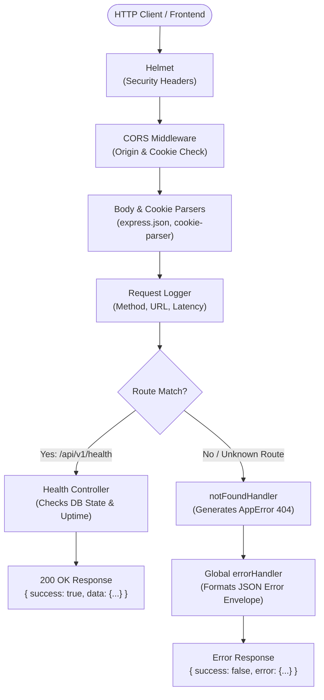
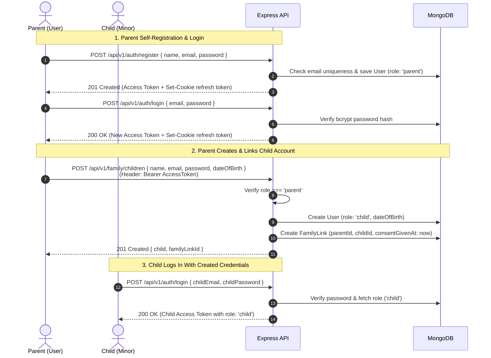
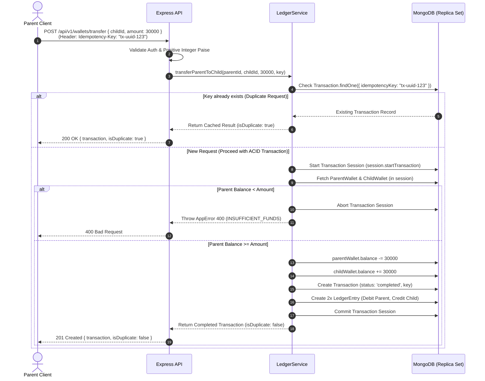
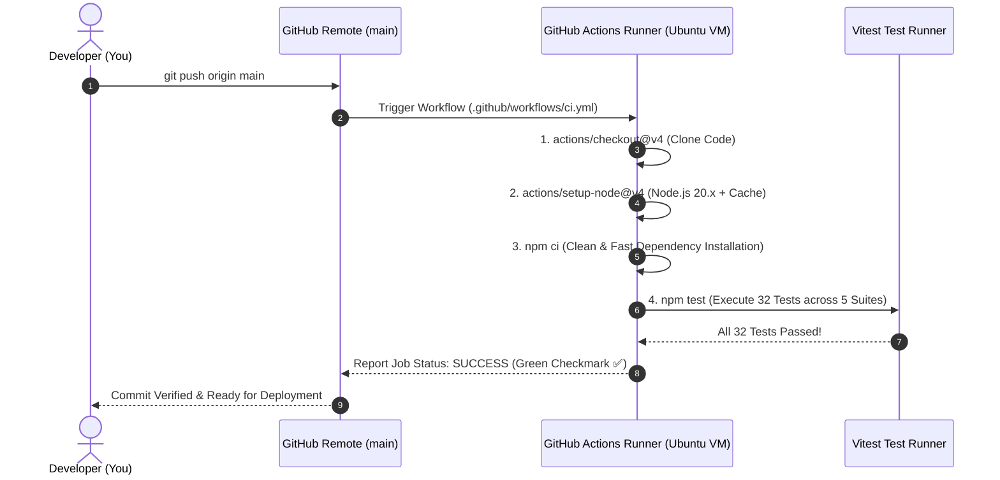
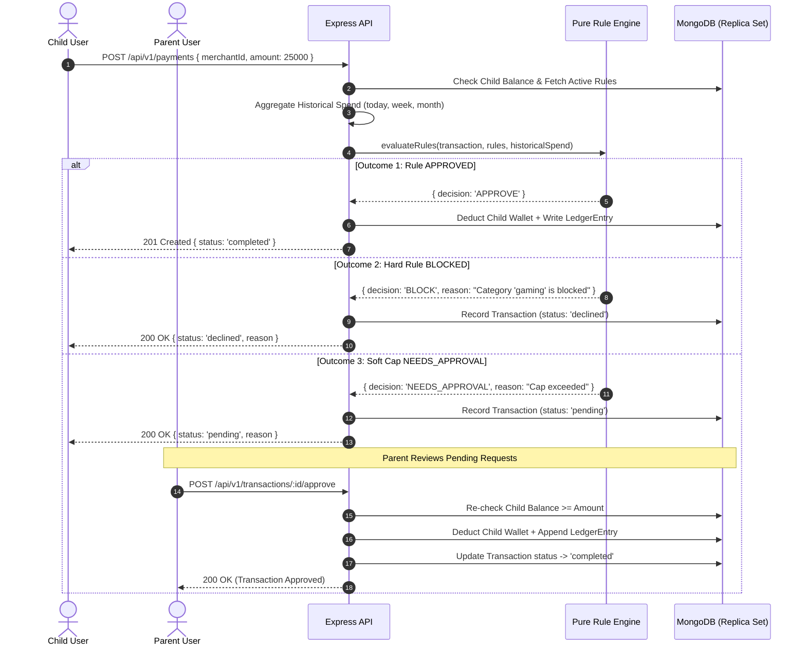
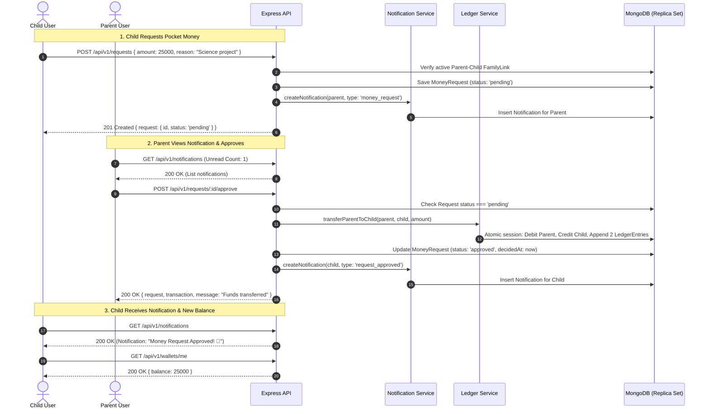

# KidLedger Wallet — Development & Learning Guide (`development.md`)

This living document tracks the phase-by-phase implementation of **KidLedger Wallet**, explaining core concepts, design trade-offs, architecture decisions, and system flow diagrams for interview preparation and codebase comprehension.

---

## 🗺️ Roadmap & Phase Tracker

- [x] **Phase 1: Foundation, Infrastructure & Error Handling**
- [x] **Phase 2: Authentication, Role-Based Access Control & Family Linking**
- [x] **Phase 3: Wallets, Append-Only Ledger & Idempotent Transfers**
- [x] **Phase 4: Simulated Merchants, Rule Engine & Approval Workflow**
- [x] **Phase 5: Money Requests & In-App Notifications**
- [ ] **Phase 6: Frontend Development (React + Tailwind)**
- [x] **DevOps Phase: Continuous Integration (CI) with GitHub Actions**
- [ ] **Phase 7: Step-by-Step Docker Containerization & Deployment**
- [ ] **Phase 8 (v2): Subscriptions, Savings Goals & LLM Spending Insights**

---

## 🏛️ Phase 1: Foundation, Infrastructure & Error Handling

### 1. Key Engineering Concepts & Interview Talking Points

1. **Currency as Integer Paise (No Floats)**
   - *Why:* IEEE 754 floating-point arithmetic causes precision loss (e.g., `0.1 + 0.2 === 0.30000000000000004`). In fintech applications, fractions of a cent accumulate drift, corrupt balance reconciliations, and fail audits.
   - *Implementation:* All monetary calculations and database models strictly use 64-bit integer paise (1 INR = 100 paise).
2. **MongoDB Replica Set for ACID Transactions**
   - *Why:* Moving money between accounts requires an atomic debit on one wallet and credit on another, plus two audit log records. If a power cut or crash occurs midway, no money can be created or lost.
   - *Implementation:* Multi-document ACID transactions in MongoDB are only supported on **replica sets**. Configured Docker Compose locally with a single-node replica set (`rs0`) to mirror production MongoDB Atlas.
3. **Decoupled Express Factory (`createApp()`)**
   - *Why:* Separating Express middleware configuration from the server listening socket allows integration tests (Vitest + Supertest) to test API endpoints in-memory without consuming system ports.
4. **Fail-Fast Environment Validation (Zod)**
   - *Why:* Silently falling back to defaults or running with missing secrets (`JWT_SECRET`, `MONGODB_URI`) causes subtle runtime crashes in production. Zod parses and validates `process.env` on boot, failing instantly with human-readable error messages if any config is invalid.

### 2. Request Flow Architecture

---

## 🔐 Phase 2: Authentication, Role-Based Access Control & Family Linking

### 1. Key Concepts & Security Architecture

1. **Dual Token Strategy (Short-lived Access + httpOnly Refresh Token)**
   - **Access Token:** Short-lived (15 minutes), signed JWT containing user claims (`sub`, `email`, `role`). Transmitted via `Authorization: Bearer <token>` header. If intercepted, the exposure window is minimal.
   - **Refresh Token:** Long-lived (7 days), stored inside an `httpOnly`, `SameSite=Lax` cookie. JavaScript running in the browser cannot read this cookie, providing strong protection against Cross-Site Scripting (XSS) token theft.
2. **Parent-Child Hierarchical Roles & Consent**
   - Minors (under 18) cannot legally consent or create unparented financial accounts.
   - Children do not self-register: **the parent creates the child's account**, recording parental consent timestamped in the `FamilyLink` model.
   - Child accounts are strictly forbidden from modifying spending rules, changing budget limits, or approving transactions.
3. **Password Security**
   - Passwords are salted and hashed using `bcryptjs` with a work factor of 10 rounds before storing in MongoDB.
   - The `passwordHash` field is configured with `select: false` on the Mongoose model so queries never leak hashes into JSON responses by accident.

### 2. Authentication & Child Linking Flow Diagram

### 3. Tested & Verified Endpoints

- `POST /api/v1/auth/register`: Parent self-registration with bcrypt password hashing.
- `POST /api/v1/auth/login`: Issues 15-min JWT access token and sets 7-day `httpOnly` cookie.
- `POST /api/v1/auth/refresh`: Seamless session renewal via cookie.
- `POST /api/v1/auth/logout`: Clears the refresh token cookie.
- `GET /api/v1/auth/me`: Authenticated endpoint returning user profile.
- `POST /api/v1/family/children`: Parent creates a minor's account with verified consent and age restrictions (<18).
- `GET /api/v1/family/children`: Parent fetches all linked children.
- **RBAC Protection:** Child accounts attempting parent routes (e.g. creating children) are rejected with `403 FORBIDDEN`.

---

## 💰 Phase 3: Wallets, Append-Only Ledger & Idempotent Transfers

### 1. Key Engineering Concepts & Interview Talking Points

1. **The Single Point of Balance Mutation (`LedgerService`)**
   - *Architecture Rule:* No controller or route can directly modify `Wallet.balance`. All money additions, transfers, or debits must be executed through `LedgerService`.
   - *Why:* Enforces separation of concerns and prevents developer errors from altering wallet balances without writing the corresponding audit records.
2. **Append-Only Immutable Ledger (`LedgerEntry`)**
   - *Why:* Financial regulations and audits demand a non-repudiable log of every debit and credit. In our Mongoose schema, all mutation hooks (`updateOne`, `deleteMany`, etc.) are actively blocked with errors.
   - *Verification:* The `reconcileWallet(walletId)` utility calculates $\sum \text{Credits} - \sum \text{Debits}$ across all historical entries and asserts it matches the cached `Wallet.balance`.
3. **Idempotency via `Idempotency-Key`**
   - *Why:* Mobile/web clients may experience network timeouts and retry requests. Without idempotency, a retry would double-charge the parent.
   - *Implementation:* Every financial route checks `idempotencyKey` before starting a session. If a record already exists, it returns the cached transaction without moving funds a second time.
4. **MongoDB Multi-Document ACID Transactions**
   - *Why:* Transferring money between two wallets requires 4 simultaneous database writes: debit parent, credit child, append parent ledger entry, append child ledger entry. If any step fails (e.g., negative balance check or server crash), MongoDB aborts the entire transaction session, leaving no partial state.

### 2. Transactional Transfer Flow Diagram

### 3. Tested & Verified Features

- Auto-initialization of parent wallet on registration and child wallet upon parental creation.
- Simulated parent top-up with positive integer paise validation.
- Duplicate idempotency key protection preventing double credits.
- Atomic parent-to-child transfers with debit/credit balance mutation.
- Insufficient funds safety checks preventing negative balances.
- Real-time reconciliation audit proving balance equals sum of ledger entries.
- Immutable schema guard preventing ledger tampering or deletion.

---

## 🚀 DevOps Phase: Continuous Integration (CI) with GitHub Actions

### 1. Key Engineering Concepts & Interview Talking Points

1. **What is Continuous Integration (CI)?**
   - CI is an automated software practice where team members integrate their code into a central repository frequently. Every integration is verified by an automated build and test runner to detect integration errors as quickly as possible.
2. **`npm ci` vs `npm install` in CI Runners**
   - *Interview Question:* Why use `npm ci` inside a pipeline?
   - *Answer:* `npm install` can update transitive dependencies and alter `package-lock.json`. `npm ci` strictly reads `package-lock.json`, deletes existing `node_modules`, and guarantees an identical, deterministic environment every single build. It is also significantly faster.
3. **Dependency Caching (`cache: 'npm'`)**
   - In GitHub Actions, each job runs on an ephemeral VM that is destroyed after completion. By caching the `~/.npm` directory against a hash of `server/package-lock.json`, unchanged dependencies are pulled from cache in seconds instead of downloading over the internet.
4. **Isolated Test Execution**
   - The CI runner runs `npm test` using `mongodb-memory-server` in replica set mode. No live databases or external cloud infrastructure need to be provisioned for testing, keeping test runs free and instant.

### 2. GitHub Actions CI Pipeline Workflow

---

## 🛡️ Phase 4: Simulated Merchants, Rule Engine & Approval Workflow

### 1. Key Engineering Concepts & Interview Talking Points

1. **Pure & Deterministic Rule Engine**
   - *Architecture Rule:* The rule engine (`evaluateRules`) is written as a 100% pure function with zero database or network calls.
   - *Why:* Pure functions have no side effects, are deterministic ($f(x) \equiv y$ every time), and allow writing comprehensive unit tests covering tricky limit boundary conditions without mocking databases.
2. **Deterministic Evaluation Precedence**
   - The engine evaluates rules in strict hierarchical order:
     1. Hard Blocks (e.g., `blocked_merchant`, `blocked_category`) $\rightarrow$ immediate `BLOCK`.
     2. Allow-Only Whitelists (`allow_only`) $\rightarrow$ if not whitelisted, immediate `BLOCK`.
     3. Financial Thresholds (`per_txn_cap`, `daily_limit`, `weekly_limit`, `monthly_limit`) $\rightarrow$ either `BLOCK` or escalate to `NEEDS_APPROVAL`.
3. **Two-Phase Approval Workflow**
   - Transactions violating soft limits enter a `pending` state instead of failing outright.
   - Money is **not deducted** when a transaction is pending. Once the parent calls `/approve`, the child wallet balance is re-verified and atomically debited inside a transactional session.

### 2. Payment & Approval Workflow Diagram

---

## 📬 Phase 5: Money Requests & In-App Notifications

### 1. Key Engineering Concepts & Interview Talking Points

1. **Asynchronous Fund Requests (Ask → Review → Atomic Deposit)**
   - *Why:* In a minor-parent relationship, allowance isn't purely push-based (parent gives money on a schedule); children frequently require money on-demand for legitimate unplanned expenses (school books, bus passes, school projects).
   - *Architecture:* The child initiates an asynchronous `MoneyRequest` specifying an amount and reason. The parent reviews this queue, and upon approval, an atomic `LedgerService.transferParentToChild` transfer runs inside a multi-document ACID session, crediting the child's wallet and debiting the parent's wallet.
2. **Concurrency & Double-Approval Prevention**
   - *Why:* If a parent accidentally double-taps "Approve" on their phone or multiple parents attempt to approve the same request simultaneously, the child could be credited twice for one request.
   - *Protection:* The request's state is strictly checked (`status === 'pending'`). Once processed, the status is set to `approved` and timestamped (`decidedAt`), and duplicate approval calls return `400 INVALID_REQUEST_STATUS`.
3. **Decoupled In-App Notification System**
   - *Why:* Users need immediate visibility into state changes without relying solely on external delivery mechanisms (like SMS or Email).
   - *Implementation:* The `Notification` model tracks notifications per user with unread counts (`readAt: null`), compound indexing on `(userId, createdAt: -1)`, and batch updates (`PATCH /api/v1/notifications/read-all`).
4. **Lifecycle Event Hooks**
   - In-app notifications are automatically triggered across all major lifecycle events:
     - `money_request`: Parent notified when child requests funds.
     - `request_approved` / `request_declined`: Child notified of parent decision.
     - `payment_pending`: Parent notified when a purchase exceeds soft caps.
     - `transfer_received`: Child notified when a friend sends them peer-to-peer money.

### 2. Money Request & Notification Sequence Diagram

---

## 🎨 Phase 6: Frontend Development (React + Tailwind CSS) (Next Up)

The frontend web app will provide responsive, role-differentiated interfaces:
- **Parent Portal:**
  - Dashboard: Family overview, Parent wallet balance, quick top-up simulation.
  - Controls: Child spending rules manager (category toggles, per-transaction caps, daily limits).
  - Approvals: Interactive inbox for pending payment requests and money requests.
  - Ledger & Statements: Full transaction history and reconciliation viewer.
- **Child Portal:**
  - Balance Card: Current wallet balance in ₹ INR.
  - Payment Simulator: Pay seeded merchants, scan shop QR codes.
  - Peer Transfer: Send money to friends by phone number (up to ₹300/day).
  - Money Requests: Form to request funds with reason + request history tracker.
  - Notifications Bell: In-app badge and notification list with mark-as-read actions.

